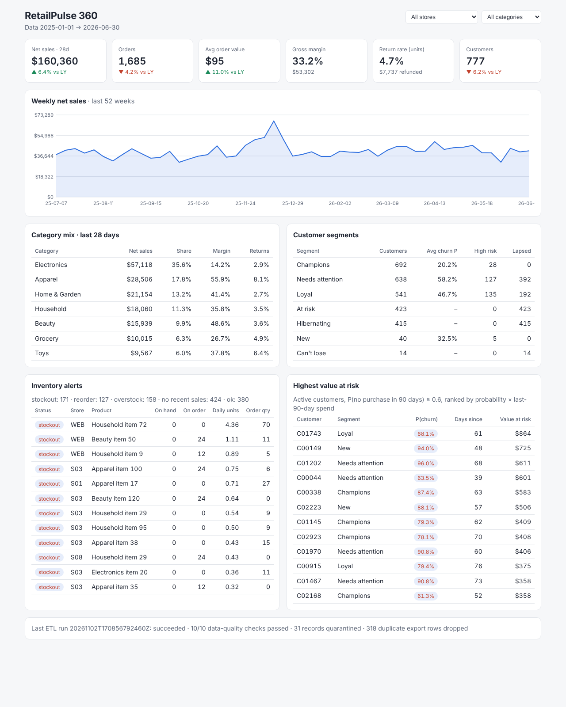

# RetailPulse 360

A small, end-to-end retail analytics platform. It takes a raw operational
export from a multi-store retailer, validates it into a star-schema warehouse,
and serves:

* **Sales KPIs**: net sales, margin, AOV, units per order, refunds, return
  rate. You can compare against the previous period and the same weeks last
  year, filter by store or category, and get time series at day, week or month
  grain.
* **Customer 360**: lifetime value, category mix, recent orders, an RFM segment
  and a **90-day churn-risk score**. The churn model is checked with an
  out-of-time backtest against a recency baseline.
* **Inventory health**: stockouts, reorder suggestions from safety stock and a
  reorder point, overstock, and items with no recent sales.
* A **FastAPI** service and a dependency-free **dashboard**.

Everything runs locally with no paid services. The data is a seeded synthetic
retailer: 9 stores including online, 140 products, 3,000 customers and 18
months of orders.



## Architecture

```
data/raw/*.csv  (operational export: stores, products, customers, orders,
      │          order_lines, returns, inventory_snapshot)
      ▼
retailpulse.etl.build_warehouse
      │  validate → quarantine bad rows (with reason) → drop exact duplicate exports
      │  load dims + facts → generate dim_date → 10 data-quality checks
      │  churn backtest + scoring → customer_scores, model_eval
      │  build into warehouse.db.building, then atomic rename (failed DQ keeps old warehouse)
      ▼
data/warehouse.db  (SQLite star schema, opened read-only by the API)
      │
      ├── retailpulse.kpis       SQL KPI queries
      ├── retailpulse.churn      features, backtest, RFM, scoring
      ├── retailpulse.inventory  safety stock / reorder point rules
      ▼
retailpulse.api (FastAPI)  ──►  /api/...  +  /  (static dashboard)
```

**Warehouse tables:** `dim_date`, `dim_store`, `dim_product` and `dim_customer`
(with a `GUEST` member for guest checkouts). `fact_sales` is at order-line
grain with gross, net and cost amounts. There is also `fact_returns`
(refunds pro-rated from the line's net amount) and `fact_inventory`. The rest
is ETL bookkeeping and model output: `etl_runs`, `etl_quarantine`,
`dq_results`, `customer_scores` and `model_eval`.

| module | role |
|---|---|
| `retailpulse/generate.py` | seeded synthetic export with realistic defects (duplicate rows, unknown products, bad quantities, unparseable timestamps, orphan returns) |
| `retailpulse/etl.py` | validation, quarantine, star-schema load, data-quality checks, atomic swap |
| `retailpulse/kpis.py` | KPI summary, period comparison, time series, breakdowns, top products |
| `retailpulse/churn.py` | leakage-safe features, out-of-time backtest, model selection, RFM segments, live scores |
| `retailpulse/inventory.py` | demand stats, safety stock, reorder point, suggested order quantity |
| `retailpulse/api.py` | REST API and dashboard route |
| `retailpulse/static/index.html` | dashboard (vanilla JS + inline SVG, light/dark, mobile friendly) |
| `retailpulse/cli.py` | `generate`, `build`, `report`, `serve` |

## Setup

Python 3.10+.

```bash
python -m venv .venv && . .venv/bin/activate
pip install -r requirements.txt        # or: pip install -e ".[dev]"
```

## Usage

```bash
python -m retailpulse generate          # data/raw/*.csv  (seed 42, 3,000 customers)
python -m retailpulse build             # data/warehouse.db, prints load/quarantine/DQ/churn summary
python -m retailpulse report            # KPIs, inventory status, churn backtest table
python -m retailpulse serve             # http://127.0.0.1:8000  (dashboard)  /docs (OpenAPI)
```

The `Makefile` wraps the same steps (`make build report serve test`).

### API

| endpoint | description |
|---|---|
| `GET /health` | data range and the last ETL run |
| `GET /api/meta` | stores, categories, ETL stats and data-quality results |
| `GET /api/kpis/summary?start&end&store&category` | KPI summary (default: last 28 days) |
| `GET /api/kpis/compare?end&days&store&category` | current vs previous window vs same window 52 weeks earlier |
| `GET /api/kpis/timeseries?grain=day\|week\|month&by=store\|region\|category\|channel` | time series (weeks are labelled by their Monday) |
| `GET /api/kpis/breakdown?by=...` | share, margin and return rate per group |
| `GET /api/products/top?limit&store` | best sellers by net sales |
| `GET /api/customers/{id}` | customer 360: profile, lifetime, categories, recent orders, score and features |
| `GET /api/customers/at-risk?limit&min_probability` | active customers ranked by probability × last-90-day spend |
| `GET /api/segments` | RFM segment sizes, average churn probability, high-risk and lapsed counts |
| `GET /api/inventory/alerts?status&store&limit` | status counts and prioritised items with suggested orders |
| `GET /api/model/churn` | the stored backtest report |

### Samples and expected outputs

`samples/raw/` is a hand-written export of about 20 rows. It includes an
exact duplicate line, an unknown product, a zero quantity, an unparseable
timestamp, an orphan return and a return larger than the quantity sold.
`samples/expected_outputs.json` holds its expected KPI summary, category
breakdown, inventory assessment and quarantine list. The numbers can be
checked by hand: net sales 190.00 = 20 + 40 + 100 + 30, gross margin 100.00,
one of eight units returned for 50.00. The tests compare against this file.

```bash
python -m retailpulse build --raw samples/raw --db data/sample.db
python -m retailpulse report --db data/sample.db
```

## Measured results (default data, seed 42)

**ETL:** 79,852 raw order lines. 79,514 were loaded, 318 exact duplicate
exports were dropped and 20 were quarantined (12 unknown products, 8
non-positive quantities). Every raw line is accounted for, and a test checks
this. Of the orders, 5 were quarantined for unparseable timestamps. Of the
returns, 6 were quarantined because they referenced missing lines. All 10
data-quality checks pass.

**KPIs, 28 days to 2026-06-30:** net sales 160,359.68, 1,685 orders, AOV 95.17,
gross margin 33.2%, return rate 4.7% of units. Against the same 28 days a year
earlier: net sales +6.4%, orders −4.2%, AOV +11.0%.

**Churn backtest:** the task is to predict no purchase in the next 90 days. The
population is customers active in the 120 days before the cutoff. Training
uses the cutoff 2026-01-01 (1,554 customers). The model is picked by ROC-AUC on
a 20% validation split of those training customers. Testing uses the later
cutoff 2026-04-01 (1,568 customers, churn rate 0.333):

| model | ROC-AUC | PR-AUC | lift@10% | Brier |
|---|---|---|---|---|
| baseline: days since last order | 0.836 | 0.732 | 2.56 | – |
| logistic regression (selected) | 0.836 | 0.746 | 2.66 | 0.148 |
| gradient boosting | 0.819 | 0.730 | 2.58 | 0.157 |

On ranking, the model only ties the recency baseline (ROC-AUC 0.836). Its gains
are small: +0.014 PR-AUC and +0.10 lift in the top decile. What it adds is a
calibrated probability (Brier 0.148), which recency alone does not give. The
dashboard's "value at risk" ranking needs that probability. Gradient boosting
did worse than logistic regression on both validation and test.

**Inventory at 2026-06-30:** across 1,260 store × product positions there are
171 stockouts, 127 to reorder, 158 overstocked, 424 with no recent sales and
380 ok.

## Design decisions

* **Rebuild and swap the warehouse instead of updating in place.** The build is
  deterministic (a test checks this), so rebuilding from the raw export is
  simple and safe. The atomic rename means the API never sees a half-built
  warehouse. If a data-quality check fails, the run stops and the previous
  warehouse stays in place.
* **Quarantine, don't drop.** Every rejected record is kept with a reason, so
  bad rows can be inspected. Exact duplicate exports are counted and dropped.
  A duplicate id with different content is a conflict and goes to quarantine.
* **The guest member is a real dimension row.** Guest orders count toward
  sales without breaking foreign keys or customer counts.
* **Returns are counted in the period of the return date.** A period's
  numbers do not change after the period closes. Refunds are pro-rated from
  the line's net amount, so they include the discount.
* **Year-over-year compares against 364 days earlier.** That keeps the weekday
  mix identical. Weeks are labelled by their Monday, so the week at a year
  boundary is not split in two.
* **Leakage-safe churn features.** Features use only orders, lines and returns
  dated on or before the cutoff. A test deletes everything after the cutoff
  and checks that the features don't change. The model is selected on
  validation data from the training period and reported on a later test
  period.
* **Lapsed customers are segmented, not scored.** Customers who have not
  bought for 120 days already churned. Scoring them would inflate the metrics
  and give no useful signal, so they get an RFM segment and a `lapsed` band
  instead of a probability.
* **Inventory rules are transparent.** The reorder point uses the standard
  formula `mean × lead time + z·σ·√lead time` with z = 1.65. A planner can
  check every suggestion by hand.
* **The dashboard has no build step.** It is vanilla JS and inline SVG served
  by the API: no CDN, no npm.

## Limitations

* **Synthetic data.** Customer behaviour, seasonality and defects come from a
  generator. Absolute numbers will differ on real data. The churn signal is
  mostly recency and frequency by construction, which is why the model barely
  beats the recency baseline.
* **One inventory snapshot.** There is no stock history, so stockout days and
  lost sales are not estimated. Demand during a stockout reads as zero.
* **Single node.** SQLite and in-process scoring. Good for one retailer's few
  hundred thousand lines, not for a chain-wide data lake.
* **No authentication.** The API is read-only, but it should not be exposed as-is.
* **Each build retrains the churn model.** Model artifacts are not versioned
  beyond the stored evaluation report.

## Tests

```bash
python -m pytest -q
```

28 tests cover:

* **ETL:** quarantine reasons, fact amounts, the guest member, every raw line
  accounted for, deterministic rebuilds, a failed DQ check keeping the old
  warehouse, and read-only access.
* **KPIs:** exact hand-computed values, filters, weeks at a year boundary, and
  year-over-year growth.
* **Inventory rules.**
* **Churn:** the leakage check, labels and population on a toy history, lift,
  the backtest report, score coverage, and skipping cleanly on tiny data.
* **API:** endpoints, validation errors and 404s.
* **CLI:** the `report` command.

GitHub Actions runs the tests and an end-to-end smoke build on Python 3.10 and
3.12.
